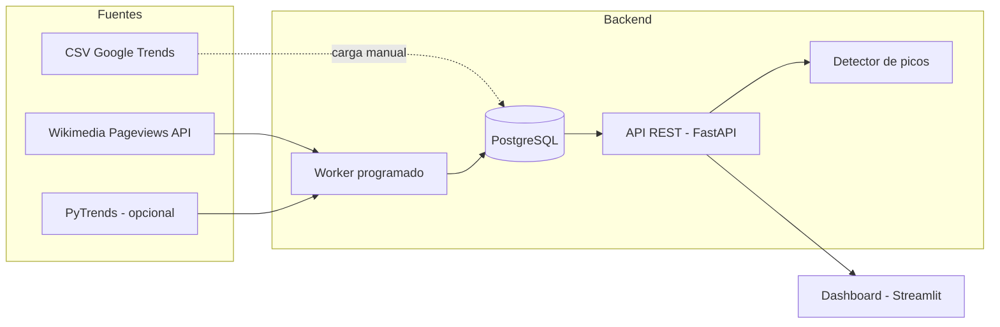
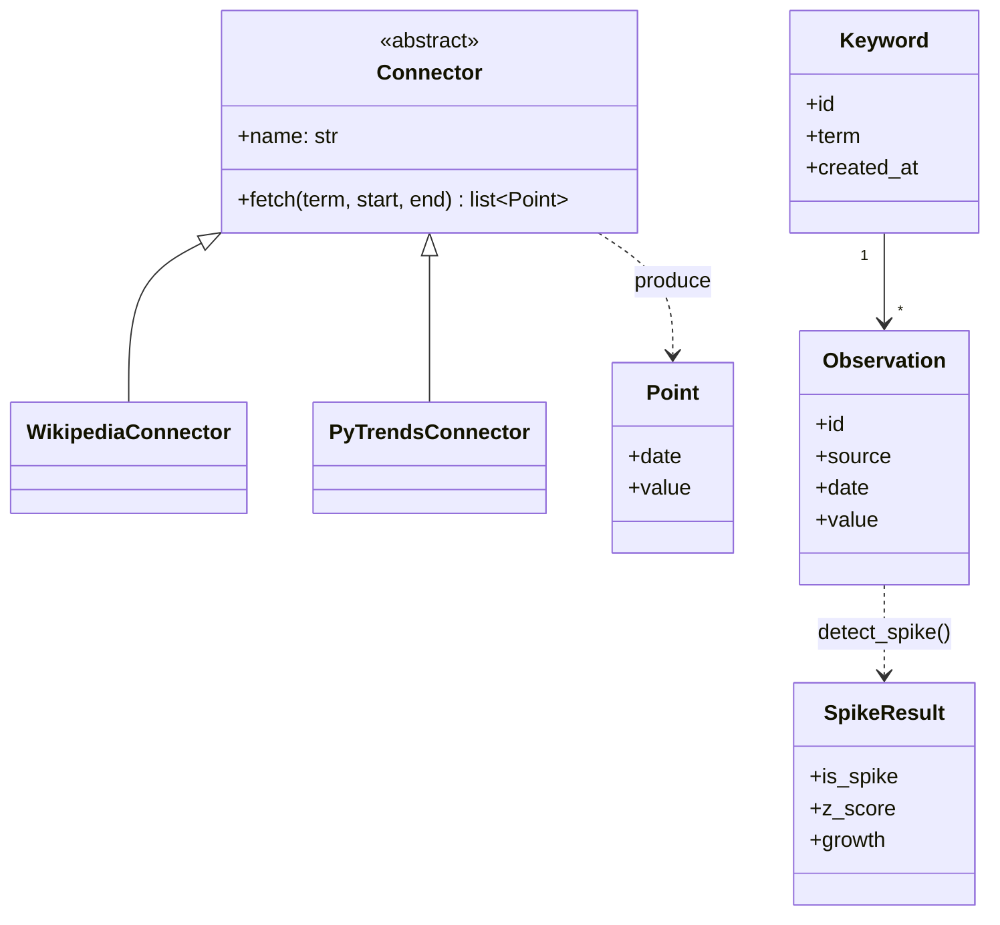
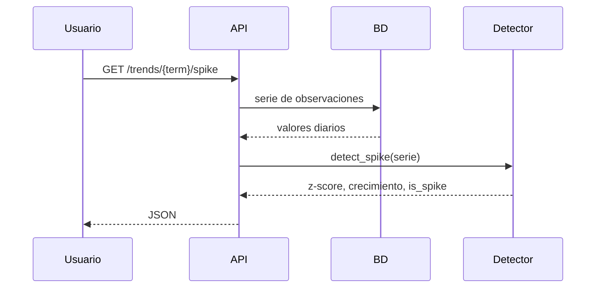

# Arquitectura

## Componentes

La configuración Docker Compose define cinco servicios: base de datos, API principal, API externa simulada, worker y dashboard.

## UML de clases (simplificado)

## Flujo de una consulta de pico

## Decisiones técnicas

| Decisión | Motivo |
|---|---|
| Conectores con interfaz común | Cambiar o añadir fuentes sin tocar el resto del sistema |
| z-score sobre media móvil de 28 días | Método simple, explicable y validable con backtest |
| FastAPI | Documentación OpenAPI automática y tipado |
| PostgreSQL en Docker (SQLite en local) | Mismo código, entorno de desarrollo sin fricción |
| Worker separado de la API | La ingesta (lenta, falla a veces) no afecta a la API |
| Docker + CI | Reproducibilidad y despliegue en cualquier proveedor de nube |

## Despliegue en la nube (por decidir)
El proveedor y el servicio (VM con docker-compose, o servicio de contenedores gestionado) están
pendientes de decisión del equipo / profesor. La arquitectura no depende de ninguno concreto.
